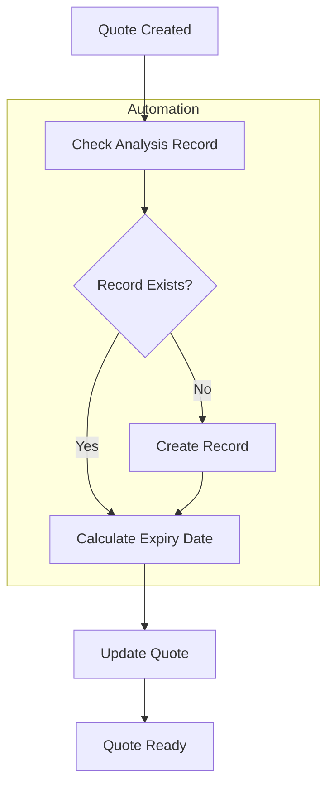

# OWAPI-Getting-Started
## Getting started with the Orderwise Web API (OWAPI)

When we moved to the Orderwise cloud offering, one of the main trade-offs we had to make was losing much of the automation we had built around our on-premises SQL database. Although this was frustrating from a functionality perspective, it made complete sense from a security standpoint. No responsible software provider would allow untrusted code to run directly within its hosted environment where it could potentially compromise the stability or security of the platform.

As a simple example, we used one of the sales order date analysis fields to record an expiry date for quotes. This allowed us to include the date on the quote layout, extend it where a prospect needed more time to make a decision, and use it to identify quotes that should be cancelled and closed off. Having this date in place allowed us to develop a user report in Orderwise that gave each member of the sales team a clear view of their currently open quotes and the associated values. Initially, we used the Orderwise Scheduled Task functionality to automatically email the relevant report to each salesperson. The process wasn't particularly robust, as it relied on the user calculating the expiry date correctly, and then entering it manually whilst entering the quote into Orderwise. This process  was often omitted or the date was calculated incorrectly, the poor data quality affected the accuracy of the reporting. To address this, we wrote SQL to automatically set the expiry date to 30 days from the date the order was entered into the system. This removed the reliance on manual calculation and ensured the expiry date was applied consistently.

While developing the SQL for the expiry-date calculation, we identified another issue. Orderwise does not automatically create an order_analysis record for a sales order, including a quote, unless the user enters a value into one of the analysis fields. To address this, we extended the SQL to check whether the corresponding order_analysis record existed and create it where necessary before setting the expiry date.

Initially, the expiry-date routine was implemented as a user report without an associated layout, these reports can be executed periodically by the Orderwise Task Scheduler. Although this automated the process, it introduced a timing dependency. Some quotes were being issued before the scheduled routine had run, resulting in documents being sent without an expiry date applied. The minimum scheduler interval is 10 minutes, unfortunately this doesn't align with the way users work. Users expected to be able to create and issue a quote immediately, so relying on a scheduled process created an unavoidable window during which the expiry date might not yet have been populated.

