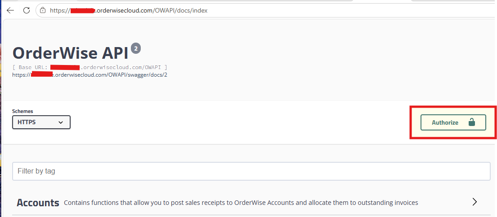

# OWAPI-Getting-Started
## Getting started with the Orderwise Web API (OWAPI)

When we moved to the Orderwise cloud offering, one of the main trade-offs we had to make was losing much of the automation we had built around our on-premises SQL database. Although this was frustrating from a functionality perspective, it made complete sense from a security standpoint. Orderwise, like any other responsible software provider doesn't allow untrusted code to run directly within its hosted environment where it could potentially compromise the stability or security of the platform.

Our approach to automation required a rethink. While rebuilding this functionality, we worked through a significant learning curve to understand how best to access and use the **OrderWise Web API (OWAPI)**.

This project is designed to shorten the learning curve and provides a practical guide to accessing the API, authenticating with the OWAPI, and using it as the foundation for future automation projects.

## Introduction

The documentation for the API can be reached at https://<tenant_name>.orderwisecloud.com//OWAPI or https://<tenant_name>.orderwisecloud.com//OWAPI/docs/index

This provides an interactive reference for the OrderWise REST API available through the organisation's OrderWise Cloud environment. The API uses HTTPS and exposes functionality across the principal areas of the OrderWise platform grouping endpoints into functional areas.

The interface also exposes the API Models, allowing developers to inspect the structures used for request and response payloads.

This online documentation should be treated as the primary technical reference when determining the appropriate endpoint, HTTP operation and data model before implementing an OrderWise API call.


*Figure 1: OrderWise API documentation landing page.*
## Quote Expiry Date Automation

As a simple example, we use one of the sales order date analysis fields to record an expiry date for quotes. Initially, our objective was simply to make it clear to customers and prospects exactly when the statement **"quote valid for 30 days"** expired, while also giving us a reliable date for internally reporting when quotes were due to expire.

### Existing Orderwise Date Fields

In the first iteration, we looked at the dates already available against a quote. Orderwise includes quotes, sales orders and transfers within the `order_header` table. As the table is primarily designed around sales orders, it contains three date fields:

- `oh_datetime`
- `oh_req_date`
- `oh_promise_date`

The Orderwise online help describes the latter two fields as:

> *Date required / promised: Both of these dates default to 2 days ahead of the order date. The days that are added to the required and promised date by default are controlled by the 'Days to add to required date in Sales' setting, located in the Sales Order Entry > Orders tree-view node in the Sales section of the System Settings. The required date is when the customer requests delivery and the promised date is when the order will actually be delivered.*

This terminology has caused a fair amount of confusion over the years, although we have become accustomed to it. A default of two days is perfectly reasonable when selling products from stock, but quoting presents a different set of requirements.

For a quote, we need to know:

- When the customer requires the product on site.
- When we need to take action to allow sufficient time for purchasing or manufacturing.
- When the quote itself expires.

The last point is particularly important where supplier pricing may change during the lifetime of the quote.

### Introducing a Quote Expiry Date

To give us a dedicated quote validity date, we decided to use an order analysis field. This gave us the flexibility to set and modify the expiry date independently of the dates used for order fulfilment.

Having a dedicated expiry date allowed us to:

- Include the expiry date on the quote layout.
- Extend the expiry date where a prospect needed more time to make a decision.
- Identify expired quotes that should be cancelled and closed.
- Report on currently open quotes and their associated values.

It also allowed us to develop an Orderwise user report that gave each member of the sales team a clear view of their currently open quotes and associated values. Initially, we used the Orderwise Scheduled Task functionality to automatically email the relevant report to each salesperson.

### Automating the Expiry-Date Calculation

The process was not particularly robust, however, because it relied on the user correctly calculating the expiry date and entering it manually while creating the quote.

In practice, the date was sometimes omitted or calculated incorrectly, and the resulting poor data quality affected the accuracy of our reporting.

To address this, we wrote SQL to automatically set the expiry date to **30 days from the date the quote was entered into the system**. This removed the reliance on manual calculation and ensured that the expiry date was applied consistently.

### Creating the `order_analysis` Record

While developing the SQL for the expiry-date calculation, we identified another issue.

Orderwise does not automatically create an `order_analysis` record for a sales order, including a quote, unless the user enters a value into one of the analysis fields.

We therefore extended the SQL to:

1. Check whether the corresponding `order_analysis` record existed.
2. Create the record where necessary.
3. Calculate the expiry date.
4. Update the analysis field with the calculated expiry date.

### Scheduled Task Approach

Initially, the expiry-date routine was implemented as a user report without an associated layout. This allowed it to be executed periodically by the Orderwise Task Scheduler.

Although this automated the process, it introduced a timing dependency. Some quotes were being issued before the scheduled routine had run, resulting in documents being sent without an expiry date.

The minimum interval available through the Orderwise Task Scheduler was **10 minutes**, which did not align particularly well with the way users actually worked.

Quite reasonably, users expected to be able to create a quote and send it to a customer or prospect almost immediately. Relying on the scheduled process therefore created an unavoidable window during which a newly created quote might not yet have had its expiry date populated.

### Moving to an SQL Trigger

To remove this delay, we analysed the SQL activity generated during the quote-creation process and identified `order_header_total` as the final table being updated.

Based on this, we moved away from the scheduled approach and implemented an `AFTER INSERT` trigger on `order_header_total`.

The trigger allowed the expiry-date routine to run as part of the quote-creation process, rather than waiting for the next scheduled task, ensuring that the expiry date was available before the quote was issued.

### Process Flow

```mermaid
flowchart TD
    A[Quote created in Orderwise]
    A --> B[order_header_total record inserted]
    B --> C[AFTER INSERT trigger executes]
    C --> D{order_analysis record exists?}
    D -->|No| E[Create order_analysis record]
    D -->|Yes| F[Use existing record]
    E --> G[Calculate expiry date]
    F --> G
    G --> H[Quote date + 30 days]
    H --> I[Update expiry date]
    I --> J[Quote ready to issue]
